# Disaster Sentinel

> **Solar-Powered Distributed Early-Warning Network with Layered Sensor Validation and PyTorch GRU AI Predictive Engine**
> Smart India Hackathon (SIH) 2026

---

### Tech Stack


---

## Project Overview

**Disaster Sentinel** is an early-warning and environmental monitoring system built for areas with limited infrastructure.

The system uses **4 solar-powered ESP32 edge sensor nodes**, each dedicated to monitoring a specific disaster type: Flood, Landslide, Fire, and Air Pollution. Each node transmits compact LoRa packets to a central **NVIDIA Jetson Orin Nano** gateway at the Disaster Relief Center.

The Jetson runs **layered sensor confirmation** and a **PyTorch GRU neural network** that predicts disaster probabilities at **T+15, T+30, and T+60 minutes** ahead of time. Alerts are sent in real-time to a web dashboard, and also via GSM SMS, a buzzer, and strobe warning lights.


## Project Gallery & Hardware Showcase

All visual assets, circuit schematics, dashboard telemetry, and hardware photographs are cataloged in [`project_images/`](project_images/).

---

### [A] System Architecture Flowchart & Complete Multi-Node Hardware Setup

| End-to-End System Architecture Flowchart |
|:---:|
|  |
| *Complete system architecture pipeline: Multi-sensor edge data acquisition, SX1278 LoRa transmission, Jetson Orin Nano edge intelligence (Random Forest + PyTorch GRU), real-time web dashboard, and multi-channel emergency alerting.* |

| Full Multi-Hazard Hardware Testbed Array (4 Solar Nodes + Jetson) | Dual-Laptop Command Station & Live Testbed Demonstration |
|:---:|:---:|
|  | 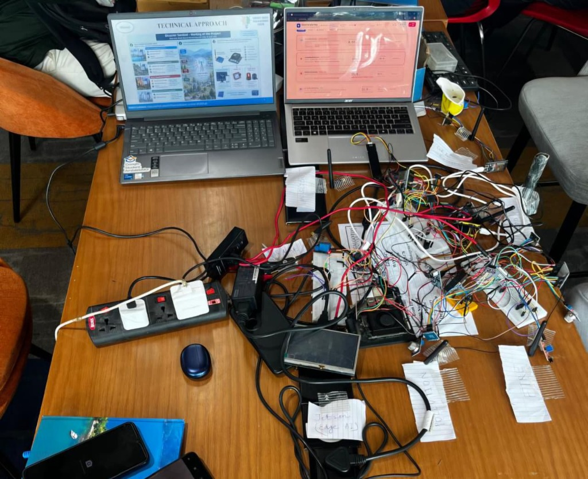 |
| *End-to-end physical testbed: All 4 dedicated solar-powered ESP32 multi-hazard sensor nodes (Flood, Landslide, Fire, Air Quality) operating concurrently with the central NVIDIA Jetson Orin Nano AI gateway and LoRa radio receiver.* | *Live hackathon command station: Dual-laptop monitoring terminal running the SIH Technical Approach poster & real-time telemetry dashboard, connected to the active Jetson gateway and 4-node cluster.* |

---

### [B] Circuit Schematics & Network Architecture

| Multi-Node Circuit Architecture | Complete System Pinout & Component Wiring Diagram |
|:---:|:---:|
|  |  |
| *LoRa star network topology connecting 4 edge nodes to Jetson* | *Full hardware pinout schematic for ESP32 nodes, sensors, and Jetson Orin Nano* |

---

### [C] Dedicated Sensor Nodes & Central AI Gateway Hardware

| Node 1: Flood Monitoring (`FLD1`) | Node 2: Landslide Monitoring (`SLD2`) |
|:---:|:---:|
| 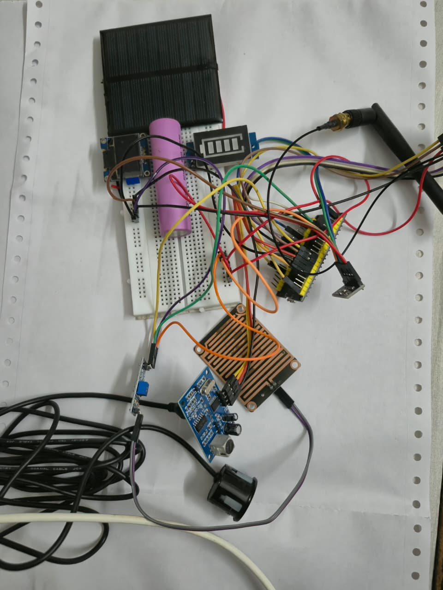 | 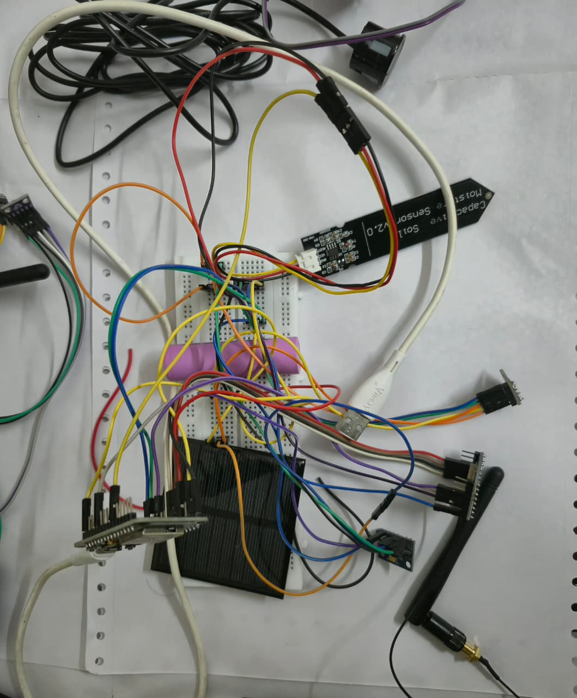 |
| *ESP32 Node FLD1: YL-83 Rain Sensor, JSN-SR04T Waterproof Ultrasonic Transducer, BME280, Solar Li-ion & LoRa 433MHz* | *ESP32 Node SLD2: Capacitive Soil Moisture Sensor v2.0, MPU-6050 Gyro/Tilt Inclinometer, Solar Li-ion & LoRa 433MHz* |

| Node 3: Wildfire Monitoring (`FIR3`) | Node 4: Air Pollution Monitoring (`POL4`) |
|:---:|:---:|
| 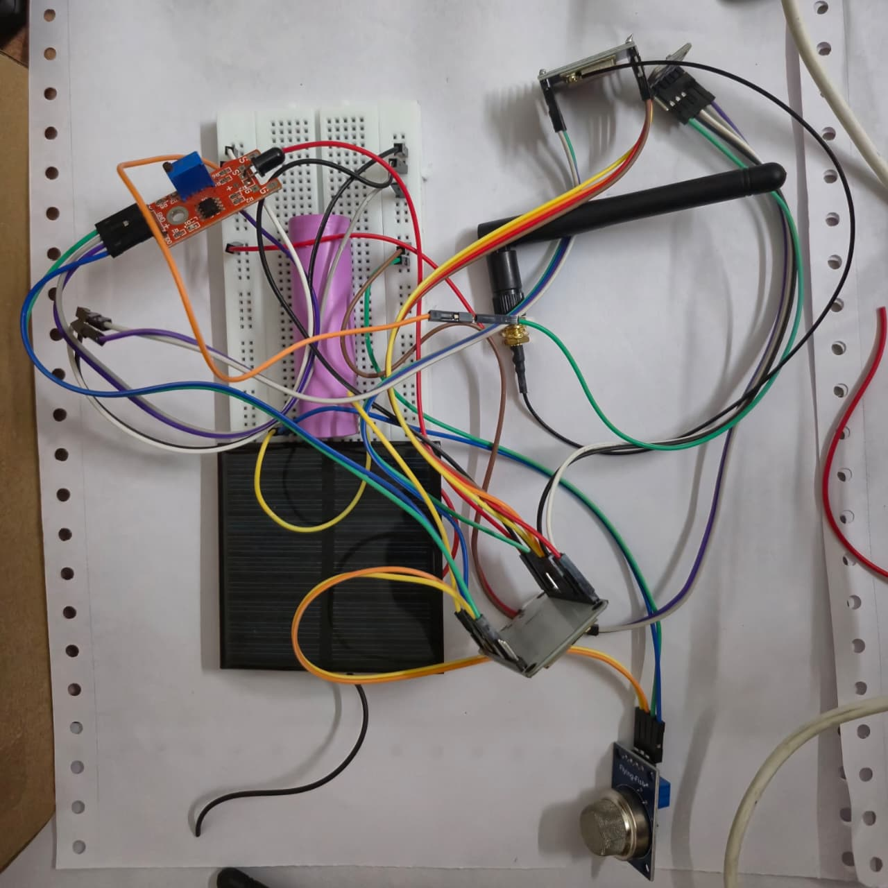 | 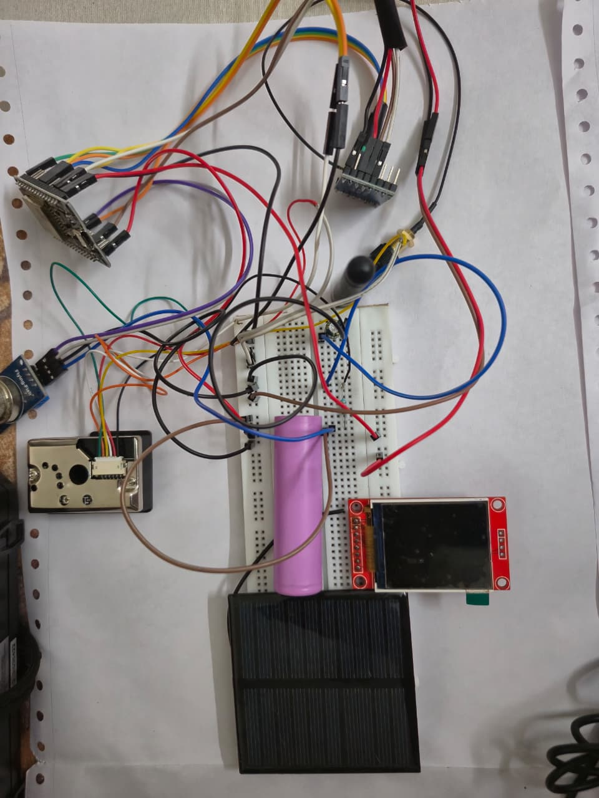 |
| *ESP32 Node FIR3: KY-026 Flame/IR Photodiode, MQ-2 Gas/Smoke, BME280, Solar Li-ion & LoRa 433MHz* | *ESP32 Node POL4: GP2Y1010AU0F Optical Dust / PM2.5, MQ-135 AQI, OLED Display, Solar Li-ion & LoRa 433MHz* |

| NVIDIA Jetson Orin Nano AI Gateway & LoRa Hub |
|:---:|
| 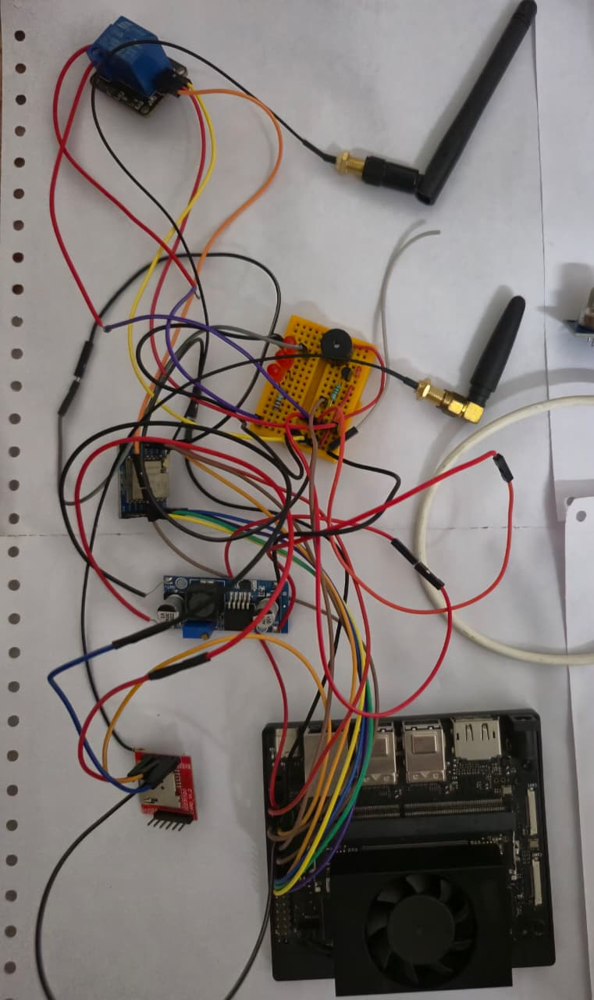 |
| *Central command hub: NVIDIA Jetson Orin Nano with active cooling, SX1278 SPI LoRa receiver, SIM800L GSM SMS module, 2N2222 active piezo buzzer driver, and 5V strobe light relay.* |

---

### [D] Field Sensor Hardware Callouts & Physical Verification

| Node 1: Sensor Callouts (`FLD1`) | Waterproof Ultrasonic Pipe Transducer |
|:---:|:---:|
|  |  |
| *Annotated Flood node: Rain plate, MPU-6050 tilt, and SX1278 LoRa radio* | *Field deployment: Waterproof JSN-SR04T ultrasonic transducer mounted on river gauge pipe* |

| Node 2: Sensor Callouts (`SLD2`) | Node 3: Sensor Callouts (`FIR3`) |
|:---:|:---:|
|  |  |
| *Annotated Landslide node: Soil moisture probe and tilt accelerometer* | *Annotated Wildfire node: KY-026 Flame/IR sensor, MQ-2 smoke detector, BME280* |

| Node 4: Sensor Callouts (`POL4`) | Central Hub & Node Bench Verification |
|:---:|:---:|
|  |  |
| *Annotated Pollution node: Optical dust PM2.5 and MQ-135 AQI detector* | *SIH qualifying bench setup: Jetson Orin Nano gateway wired to active sensor stations* |

---

### [E] Prototype Assembly & Breadboard Clustering

| Microcontroller Core Wiring | Breadboard Prototyping Layout |
|:---:|:---:|
|  |  |
| *ESP32 microcontroller pinout header assembly and bus routing* | *Breadboard prototyping of sensor bus and power regulation* |

| Sensor Bus & Power Rails | Multi-Node Transmitter Array |
|:---:|:---:|
|  |  |
| *Top-down view of power distribution rails and LoRa SPI connections* | *Benchtop testbed of multi-node LoRa transmitters operating concurrently* |

| Jetson SPI LoRa Header Wiring |
|:---:|
|  |
| *Jetson Orin Nano 40-pin GPIO header connections: SPI0 bus, interrupt line (DIO0), and reset control* |

---

### [F] Central Command Web Dashboard & 3D Tactical GIS

| Master Executive Overview (`/dashboard`) | Live Multi-Hazard Telemetry (`/monitoring`) |
|:---:|:---:|
| 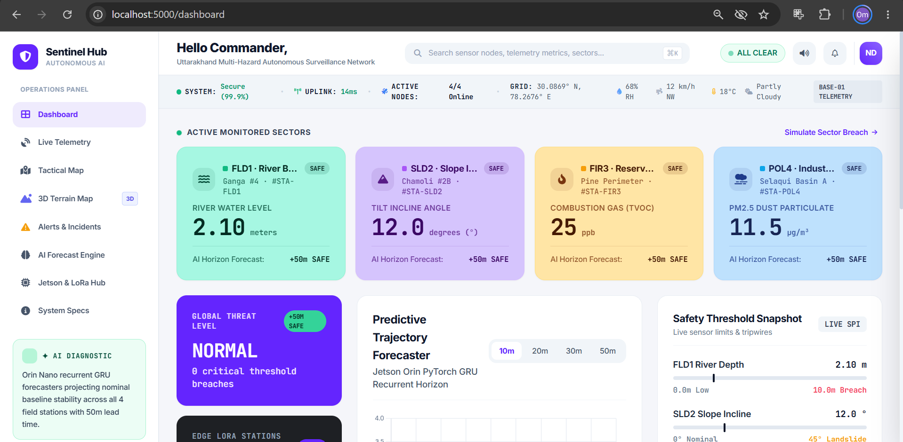 | 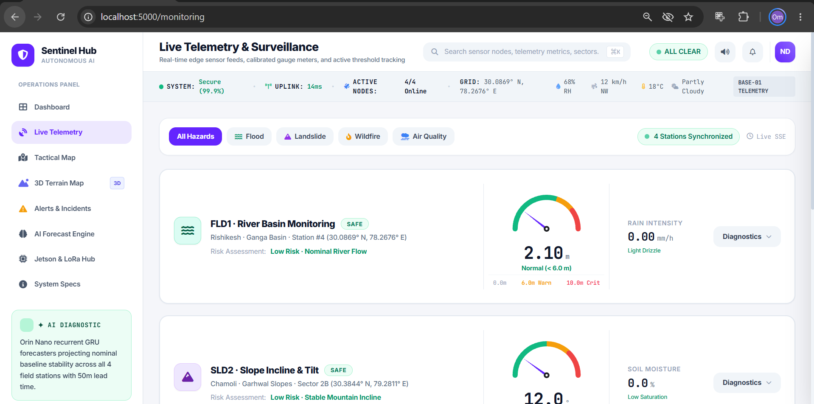 |
| *Situational awareness command panel: 4 hazard status cards, global threat index, GRU trajectory, and safety tripwires.* | *Real-time telemetry streams with calibrated radial gauges, sensor diagnostics, and active thresholds.* |

| Tactical 2D GIS Disaster Map (`/map`) | 3D Himalayan Tactical Terrain GIS (`/map3d`) |
|:---:|:---:|
| 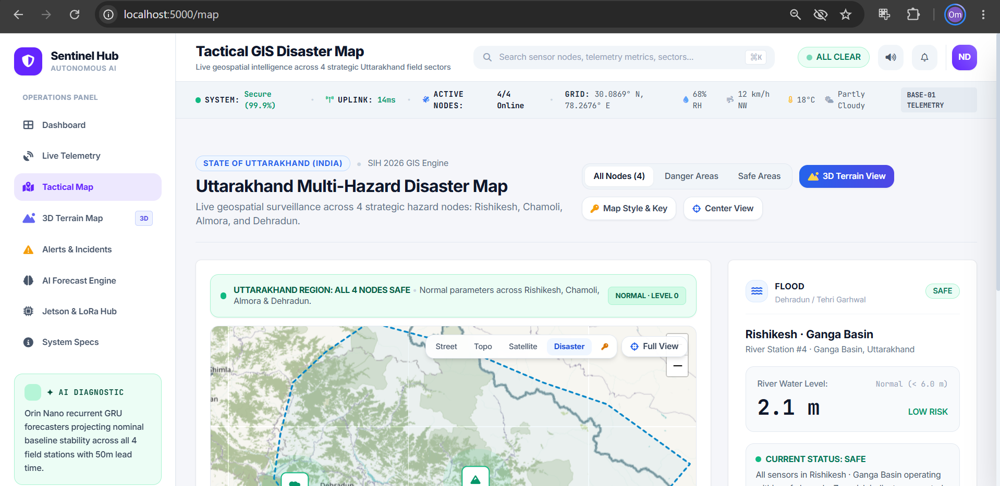 | 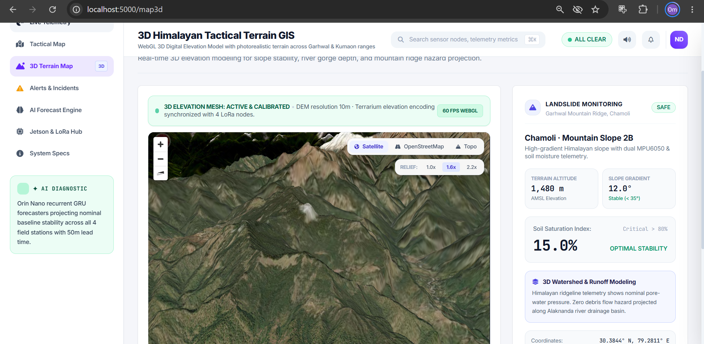 |
| *Interactive Leaflet GIS map with Uttarakhand regional bounds, threat radiuses, and sensor station inspector.* | *WebGL 3D Digital Elevation Model with satellite imagery, Himalayan elevation relief, and 3D node markers.* |

| 3D Topographic Contour & Ridge View (`/map3d`) | PyTorch GRU AI Forecast Engine (`/analytics`) |
|:---:|:---:|
| 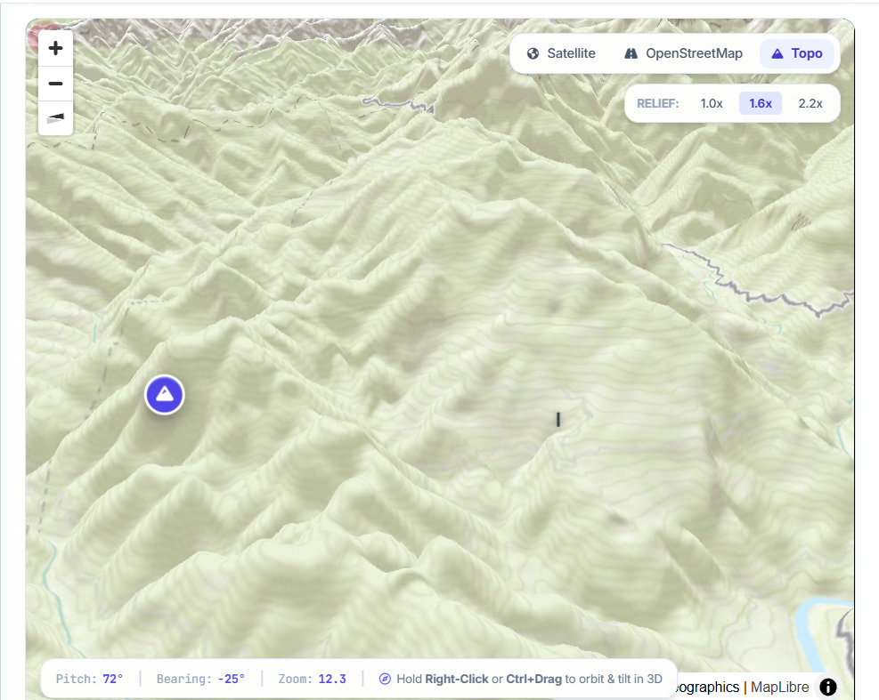 | 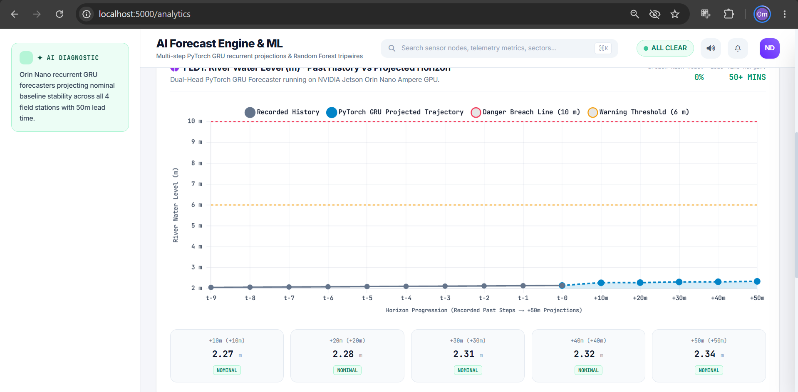 |
| *3D topographic contour lines highlighting mountain slopes and runoff channels for landslide & flood analysis.* | *Deep learning recurrent forecast: Recorded historical steps vs projected +10m to +50m trajectory.* |

| Multi-Variable LoRa Historical Telemetry Stream (`/analytics`) |
|:---:|
| 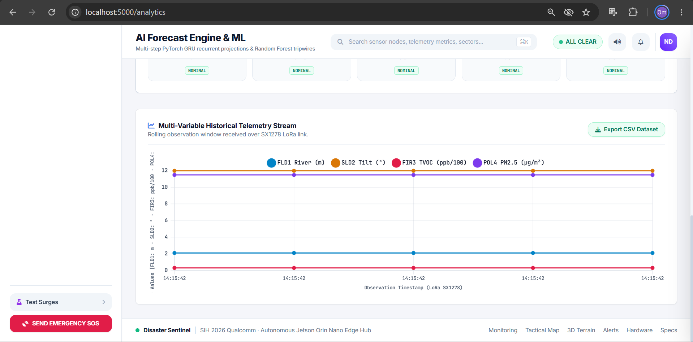 |
| *Rolling observation window of LoRa packets across all 4 field stations with one-click CSV dataset export.* |

---

### [G] Technical Posters & Documentation

| SIH Technical Approach (Page 1) | System Architecture & Pipeline (Page 2) |
|:---:|:---:|
|  |  |
| *Problem statement, solution overview, and system features* | *Layered validation architecture and hardware-in-the-loop pipeline* |

| Implementation & Results (Page 3) |
|:---:|
|  |
| *Hardware setup, field validation results, and edge deployment specifications* |

---

## Layered Sensor Confirmation

To eliminate false alarms, every disaster type is validated across multiple dedicated sensor layers:

| Disaster | Node ID | Mode | Layer 1 (Primary) | Layer 2 (Corroborating) | Layer 3 (Context) |
|----------|---------|------|-------------------|--------------------------|--------------------|
| **Flood** | `FLD1` | 3-Layer | BME280 (Pressure drop + High humidity) | Rain Sensor (YL-83) | Ultrasonic Water Level (HC-SR04) |
| **Landslide** | `SLD2` | 3-Layer | BME280 (Pressure & Rain storm context) | Capacitive Soil Moisture | MPU6050 (Tilt & Gyro Vibration) |
| **Fire** | `FIR3` | 3-Layer | BME280 (Temp spike + Humidity drop) | MQ-2 Gas/Smoke Sensor | Flame/IR Sensor (KY-026) |
| **Pollution** | `POL4` | 2-Layer | Bypassed in 2-Layer Mode | PM2.5 Dust Sensor (GP2Y1010AU0F) | MQ-135 Air Quality (AQI) |

### Alert Rules

**3-Layer Nodes (FLD1, SLD2, FIR3):**
- [RED] All 3 layers triggered AND combined score >= 0.75 -> Full alert: Dashboard + SMS + Buzzer + Strobe
- [ORANGE/YELLOW] 1 to 2 layers triggered -> Warning shown on dashboard
- [GREEN] Single-layer trigger only -> Rejected as a false alarm

**2-Layer Node (POL4):**
- [RED] Both layers triggered AND combined score >= 0.75 -> Full alert
- [ORANGE/YELLOW] 1 layer triggered AND combined score >= 0.55 -> Warning

---

## Hardware Pin Connections

A summary of pin connections for all 4 ESP32 nodes and the Jetson gateway. For full schematic diagrams and power wiring, see [hardware_pinout_guide.md](hardware_pinout_guide.md).

### LoRa Module (SX1278) -- Common to All 4 Nodes

| SX1278 Pin | ESP32 Pin | Notes |
|---|---|---|
| SCK | GPIO 18 | SPI Clock |
| MISO | GPIO 19 | SPI Master-In-Slave-Out |
| MOSI | GPIO 23 | SPI Master-Out-Slave-In |
| NSS / CS | GPIO 5 | SPI Chip Select |
| RST | GPIO 14 | Hardware Reset |
| DIO0 | GPIO 2 | Interrupt (IRQ) |
| VCC | 3.3V | 3.3V Power |
| GND | GND | Ground |

### Node 1: Flood Monitoring (FLD1)

| Component | Pin | ESP32 Pin | Function |
|---|---|---|---|
| HC-SR04 Ultrasonic | TRIG / ECHO | GPIO 12 / GPIO 13 | Water level measurement |
| YL-83 Rain Sensor | AO / DO | GPIO 34 / GPIO 27 | Rain density reading |
| BME280 | SDA / SCL | GPIO 21 / GPIO 22 | Temperature, pressure, humidity |
| Battery Monitor | ADC | GPIO 36 | Voltage divider (10k/10k) |

### Node 2: Landslide Monitoring (SLD2)

| Component | Pin | ESP32 Pin | Function |
|---|---|---|---|
| MPU6050 Gyro/Tilt | SDA / SCL | GPIO 21 / GPIO 22 | Ground tilt & vibration |
| Soil Moisture v1.2 | AOUT | GPIO 32 | Soil water saturation |
| BME280 | SDA / SCL | GPIO 21 / GPIO 22 | Temperature, pressure, humidity |
| Battery Monitor | ADC | GPIO 36 | Voltage divider (10k/10k) |

### Node 3: Fire Monitoring (FIR3)

| Component | Pin | ESP32 Pin | Function |
|---|---|---|---|
| KY-026 Flame Sensor | AO / DO | GPIO 34 / GPIO 27 | Infrared flame detection |
| MQ-2 Smoke/Gas | AO / DO | GPIO 35 / GPIO 26 | Gas concentration reading |
| BME280 | SDA / SCL | GPIO 21 / GPIO 22 | Temperature, pressure, humidity |
| Battery Monitor | ADC | GPIO 36 | Voltage divider (10k/10k) |

### Node 4: Air Pollution Monitoring (POL4 -- 2-Layer Mode)

| Component | Pin | ESP32 Pin | Function |
|---|---|---|---|
| MQ-135 Air Quality | AO / DO | GPIO 34 / GPIO 27 | AQI reading |
| GP2Y1010AU0F Dust | LED Drive / Vo | GPIO 12 / GPIO 35 | PM2.5 dust density |
| Battery Monitor | ADC | GPIO 36 | Voltage divider (10k/10k) |

### Jetson Orin Nano -- Gateway & Alert System

| Device | Device Pin | Jetson 40-Pin Header | Pin No. | Notes |
|---|---|---|---|---|
| SX1278 LoRa | MOSI / MISO / SCK / CS | SPI0 pins | 19 / 21 / 23 / 24 | SPI LoRa interface |
| SX1278 LoRa | RST / DIO0 | GPIO25 / GPIO04 | Pin 22 / Pin 7 | Reset & IRQ |
| SIM800L GSM | TXD / RXD | UART1_RXD / TXD | Pin 10 / Pin 8 | SMS alerts |
| Piezo Buzzer | Signal / GND | GPIO18 / GND | Pin 12 / Pin 14 | Audio alarm |
| Strobe Relay | IN | GPIO23 | Pin 16 | 5V relay for warning light |

---

## PyTorch GRU AI Prediction Engine

The system includes a lightweight GRU (Gated Recurrent Unit) time-series model running locally on the Jetson:

- **Input**: 30-timestep sliding window of sensor anomaly scores.
- **Output**: Disaster probability forecasts for **T+15**, **T+30**, and **T+60 minutes**.
- **Auto-Training**: If model weights are missing at startup, the system automatically generates synthetic data and trains the model (~30 seconds) before serving alerts.

---

## Quick Start Guide

### 1. Run the Central Command Web Dashboard & 3D Tactical GIS

Run the full Flask Central Command server with real-time PyTorch GRU forecasting and 3D WebGL terrain mapping:

```bash
python web/server.py
```

- **Executive Command Dashboard**: [http://localhost:5000](http://localhost:5000)
- **Live Telemetry & Gauges**: [http://localhost:5000/monitoring](http://localhost:5000/monitoring)
- **Tactical 2D GIS Map**: [http://localhost:5000/map](http://localhost:5000/map)
- **3D Himalayan Tactical Terrain GIS**: [http://localhost:5000/map3d](http://localhost:5000/map3d)
- **AI Forecast Engine**: [http://localhost:5000/analytics](http://localhost:5000/analytics)

### 2. Run the Gateway Orchestrator (Simulation Mode)

No hardware required for simulated LoRa test streams:

```bash
cd jetson
python main.py --simulate --port 8080
```

Open embedded FastAPI SPA: `http://localhost:8080`

### 3. Train or Retrain the AI Models

```bash
python ai/jetson_model/train_gru_model.py --epochs 100
```

Model weights are saved to `jetson/data/models/`.

### 3. Run Disaster Scenarios

```bash
# Pollution event (AQI & PM2.5 escalation)
python simulation/pollution_scenario.py

# Flood event
python simulation/flood_scenario.py

# Fire event
python simulation/fire_scenario.py

# Landslide event
python simulation/landslide_scenario.py

# False alarm rejection test
python simulation/false_alarm_scenario.py
```

### 4. Flash ESP32 Firmware

```bash
# Node 1 (Flood - FLD1)
cd firmware/node_flood && pio run -t upload

# Node 2 (Landslide - SLD2)
cd firmware/node_landslide && pio run -t upload

# Node 3 (Fire - FIR3)
cd firmware/node_fire && pio run -t upload

# Node 4 (Pollution - POL4)
cd firmware/node_pollution && pio run -t upload
```

---

## Repository Structure

| Folder / File | What it contains |
|---|---|
| `ai/jetson_model/train_gru_model.py` | PyTorch GRU model trainer for all 4 disaster types |
| `firmware/node_flood/` | ESP32 firmware for Flood node (FLD1) — 3-layer mode |
| `firmware/node_landslide/` | ESP32 firmware for Landslide node (SLD2) — 3-layer mode |
| `firmware/node_fire/` | ESP32 firmware for Fire node (FIR3) — 3-layer mode |
| `firmware/node_pollution/` | ESP32 firmware for Pollution node (POL4) — 2-layer mode |
| `jetson/config.yaml` | Central configuration for all 4 nodes and Jetson settings |
| `jetson/main.py` | Master startup script — launches all services on the Jetson |
| `jetson/receiver/` | SX1278 SPI LoRa packet receiver and binary decoder |
| `jetson/data/models/` | Trained PyTorch GRU model weight files (.pt) |
| `jetson/engine/three_layer_validator.py` | 3-layer and 2-layer sensor confirmation logic |
| `jetson/engine/ai_predictor.py` | PyTorch GRU neural network and prediction manager |
| `jetson/engine/risk_predictor.py` | Risk scoring, severity levels, and ETA calculation |
| `jetson/alerts/` | SMS (SIM800L), buzzer, and strobe light alert drivers |
| `web/server.py` | Flask Central Command Server with REST API & 3D WebGL GIS engine |
| `web/templates/` | Multi-page templates: Dashboard, Monitoring, 2D Map, 3D Terrain, Analytics |
| `web/templates/map3d.html` | WebGL 3D Himalayan Digital Elevation Model (DEM) with MapLibre GL |
| `jetson/dashboard/app.py` | FastAPI web server with REST API and WebSocket support |
| `jetson/dashboard/static/` | Frontend CSS and JavaScript for the web dashboard |
| `jetson/dashboard/templates/` | HTML shell for the Single-Page Application |
| `project_images/` | All hardware photos, circuit schematics, and dashboard screenshots |
| `hardware_pinout_guide.md` | Full hardware pin wiring and power circuit reference |
| `simulation/` | Scenario scripts to simulate disaster events for testing |

---

## License

Built for **Smart India Hackathon (SIH) 2026**.
