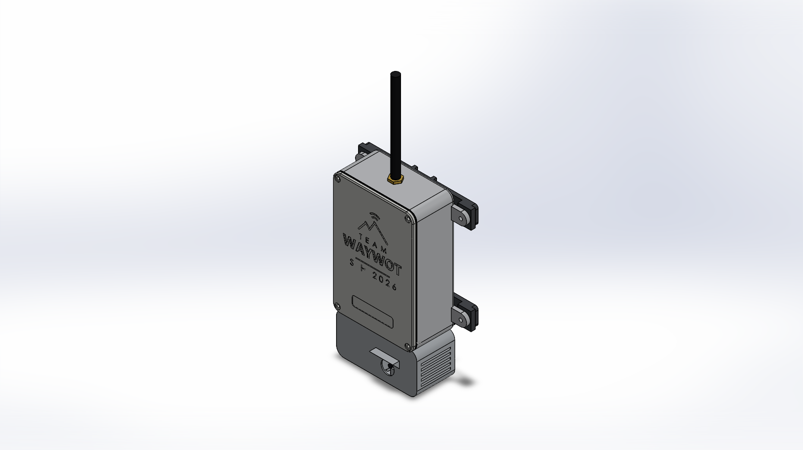
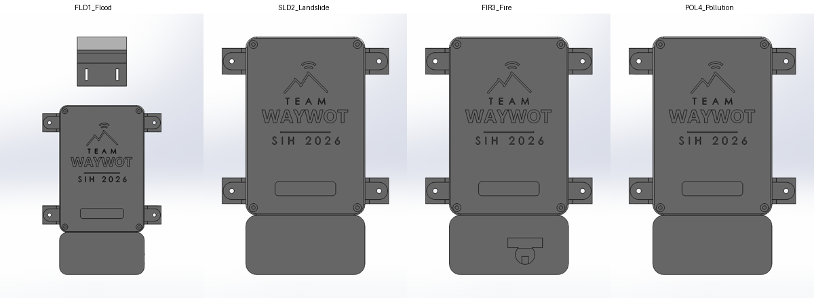

# Sentinel field-node enclosures (FLD1 · SLD2 · FIR3 · POL4)

3D-printable IP65 enclosures for the four Disaster Sentinel LoRa nodes, made for unattended
mountain sites in Uttarakhand (monsoon rain, strong UV at altitude, sub-zero nights, condensation).
Modelled in SolidWorks 2024 through the [solidworks-mcp](https://github.com/MatteoBaisini/solidworks-mcp)
server. They're an adaptation of the downloaded *IP65 Junction Box with Lock* (`../ip65-junction-enclosure-with-lock`):
same look (rounded box, gasketed rim, side mounting ears), shrunk from 300×200×170 mm to
**110×165×52 mm**, with a screw lid instead of the hinge and latches, which don't print well.



## Concept: one sealed box + one vented sensor pod per node

```
          pole (40–110 mm)
            ║   ┌───────────────┐  ← antenna bulkhead, 10 mm hole on top wall (O-ring)
  rail ═════╬═══╡  MAIN BOX     │     sealed IP65: ESP32 + Ra-02 + TP4056 + 2×18650
            ║   │  (common)     │     on a 70×90 perfboard. TPU gasket + 4× M3 lid screws
  rail ═════╬═══╡               │
            ║   ├───────────────┤  ← 3× PG7 gland + M12 breather vent, all facing DOWN
            ║   │  SENSOR POD   │     open to the air: 45° louvers on both sides, slotted floor,
            ║   │  (per node)   │     shaded from sun and rain by the box above
            ║   └───────────────┘
```

* Everything that must **touch the outside air** (BME280, MQ-2/MQ-135, GP2Y1010, flame sensor,
  ultrasonic probe) lives in the **pod**. The box above shades it, and it works like a small
  Stevenson screen.
* Everything that must **stay dry** (ESP32, LoRa, charger, batteries, sensor driver boards) is in
  the **sealed main box**.
* Every cable enters the box **from below** through PG7 glands. No hole faces the sky except the
  antenna bulkhead (10 mm hole), which has its own O-ring.

## Which sensor goes where

| Node | In the sealed main box | In the vented pod | Outside on its own mount |
|---|---|---|---|
| **FLD1 Flood** | ESP32, Ra-02, TP4056, 2×18650, JSN-SR04T driver board, YL-83 LM393 comparator | BME280 (card slot, left louvers), **JSN-SR04T probe** in the floor socket, looking straight down at the water | **YL-83 rain plate** on `SN_Flood_RainPlateMount`, clamped to the pole above the box, 20° tilt so water runs off |
| **SLD2 Landslide** | ESP32, Ra-02, TP4056, 2×18650, **MPU6050 screwed flat on the perfboard** (the box must be rigid on its stake; see mounting) | BME280 | **Capacitive soil sensor v1.2** in the ground; its electronics end is sealed in `SN_Landslide_SoilProbeCap` filled with silicone; cable comes up through the pod-floor hole |
| **FIR3 Fire** | ESP32, Ra-02, TP4056, 2×18650 | BME280 in the **left (cool) chamber**; **MQ-2** and **KY-026** in the right chamber, behind a divider so the 0.8 W MQ heater doesn't bias the temperature reading; KY-026 looks through an **18 mm IR window** (25×2 mm acrylic or glass disc) under a 45° rain visor | — |
| **POL4 Pollution** | ESP32, Ra-02, TP4056, 2×18650 | **MQ-135** (card slot) and **GP2Y1010AU0F** lying flat on 4 posts so air rises through its sensing hole; the louvers keep it dark, as the Sharp sensor needs | — |

The OLED (FLD1) and ST7735 TFT (POL4) are left out of the field build: nobody reads them at a remote
site, and they cost power. Keep using them on the bench.

## Front logo: TEAM WAYWOT · SIH 2026



Every lid carries the team logo, engraved **0.8 mm** deep into the front: a line-art mark (two
Himalayan peaks with LoRa signal arcs from the summit), then "T E A M" (Century Gothic, tracked),
"**WAYWOT**" (Segoe UI Bold, 12 mm), a thin rule, and "S I H  2 0 2 6" (Century Gothic). Strokes
are at least 1.6 mm wide and the small text is 6–7 mm tall, so they print cleanly with a 0.4 mm nozzle. The
lid prints face-down, so the logo forms on the bed side and comes out with a smooth, sharp finish.
The small panel under the logo takes a node-ID sticker (FLD1 / SLD2 / FIR3 / POL4).

To make the logo stand out:
* **Paint fill (easiest):** wipe white or orange outdoor acrylic over the logo, then scrape the face
  clean with a card while it's still wet. The paint stays in the engraving.
* **Two-colour print:** pause at **0.8 mm** (end of layer 4 at 0.2 mm) and swap filament. The
  face then shows the first colour and the engraving shows the second.

The artwork lives in [`cad/logo.py`](cad/logo.py); `build_common.py lid` rebuilds only the lid.
SolidWorks needs static fonts: Bahnschrift is a variable font with overlapping glyph outlines, and
those come out with holes (a T without its stem).

## Part list (print per node)

| File (`stl/`) | Qty | Material | Print orientation |
|---|---|---|---|
| `SN_Base` | 1 | ASA (or PETG) | back face on the bed, opening up |
| `SN_Lid` | 1 | ASA | outside face on the bed (skirt up) |
| `SN_Gasket_TPU` | 1 | **TPU 95A** | flat |
| `SN_Pod_<node>` | 1 | ASA | floor on the bed (as mounted). Louvers are 45° and print without supports |
| `SN_PoleRail` | 2 | ASA | flat, ribs up |
| `SN_BatteryClamp` | 1 | ASA | flat |
| `SN_Flood_RainPlateMount` | 1 (FLD1) | ASA | lying on its side (the side face on the bed) |
| `SN_Landslide_SoilProbeCap` | 1 (SLD2) | ASA | closed end on the bed |

**Slicer settings for a weather seal:** 0.2–0.28 mm layers, **5 walls/perimeters** (the 3 mm
walls come out fully solid), 5 top and 5 bottom layers, 30 % gyroid infill, no supports.
Use ASA where possible: PLA softens in a sun-heated box, and PETG yellows and gets brittle
under Himalayan UV within a couple of years. ABS works too if you paint it.
Filament per node is about 370 g. Print time per node is roughly 14–18 h on a 0.4 mm nozzle;
with a 0.6 mm nozzle and 0.3 mm layers it's about 7–9 h (the box is the longest part, about half of that).

## Hardware to buy (per node)

| Item | Qty | Note |
|---|---|---|
| PG7 nylon cable gland, 3–6.5 mm cable | 3 | 12.5 mm hole. G1 = sensor A, G2 = sensor B, G3 = solar |
| M12×1.5 **breather / pressure-equalising vent** (ePTFE membrane) | 1 | Stops the box breathing in moist air every night and fogging up. Fitted in the bottom wall |
| Antenna bulkhead with O-ring + U.FL pigtail (10–15 cm) | 1 | **10 mm hole** in the top wall, backed by a Ø20 × 3 mm inner boss (6 mm of wall to clamp). Fits 3/8" or M10-thread bulkheads directly (TNC / waterproof antenna mounts). A standard SMA bulkhead (1/4", ≈6.4 mm) needs a rubber/nylon reducing washer on each side. The 433 MHz antenna screws on outside, pointing straight up |
| M3 brass heat-set inserts (M3×5.7, Ø4.0 hole) | 8 | 4 for the lid pillars, 4 under the pod |
| M3×16 stainless socket or button screws + nylon washers | 4 | lid |
| M3×12 stainless | 4 | pod → box, inserted from below through the pod floor |
| M3×8 self-tapping (or M3 screws in Ø2.5 holes) | 6 | perfboard (4), battery clamp bar (2) |
| M4×20 stainless + nyloc nut + washers | 4 | ears → pole rails |
| Stainless hose clamps, 12.7 mm band, sized to the pole | 2 | pole 40–110 mm |
| 2 mm EVA/neoprene foam tape | — | between the battery holder and the clamp bar |
| Silica-gel sachet (5 g) | 1 | inside the box; replace on every service visit |
| 25 × 2 mm acrylic or glass disc | 1 | FIR3 only, IR window (glue from inside with neutral-cure silicone) |
| Neutral-cure silicone / hot glue | — | sensor card slots, probe socket, window |

## Fixed dimensions (from datasheets / measured stock parts)

| Part | Size used | Source / note |
|---|---|---|
| ESP32-DevKitC V4 (38-pin) | PCB **27.94 × 50.85 mm**, header rows **25.40 mm** apart, 19 pins over 48.26 mm; the WROOM-32 antenna overhangs the top edge by 6.04 mm. Sits on 8.5 mm female headers on the perfboard | Espressif `esp32_devkitc_v4_dimensions.pdf` |
| Ra-02 (SX1278) | 17 × 16 mm, on the perfboard with U.FL → SMA pigtail | Ai-Thinker |
| 2×18650 **parallel** holder | 77–78 × 40–41 × 21 mm → cradle **79.4** × 41.6 | check that it's wired in parallel (1S2P) and not series: TP4056 is a 1-cell charger |
| Perfboard | 70 × 90 mm on standoffs at **63.5 × 83.82 mm** (25 × 33 holes of 2.54 mm pitch) | hole positions vary between boards, so **drill those 4 holes out to 2.5–3 mm** at the grid positions |
| GP2Y1010AU0F | 46 × 30 × 17.6 mm | Sharp datasheet |
| JSN-SR04T probe | **18.2 mm socket** (`JSN_D` in `cad/params.py`) | sellers quote 18 mm and 23 mm holes for different versions. **Measure your probe**, change `JSN_D`, and re-run `build_pods.py flood` |
| MQ-2 / MQ-135 module | 32 × 22 mm PCB → 33.6 mm card slot | |
| GY-BME280 | 15.4 × 11.6 mm PCB → 16.6 mm card slot | sellers quote 15.3–15.4 × 11.5–11.6 |
| KY-026 | 36 × 15 mm → 36.6 mm card slot, 14 mm block so the IR LED lines up with the window | bend the LED so it points through the window |
| YL-83 / FC-37 rain plate | 54 × 40 mm | stick it to the tray with outdoor VHB tape |
| PG7 gland | 12.5 mm hole, 19 AF nut; glands at x = −10.5 / 10.5 / 32 and the M12 vent at −32 (21.5 mm apart, so the nuts clear each other, the lid pillars and the pod bosses) | |

## Electronics reference models and fit check

Every node assembly (`cad/SN_Node_*.SLDASM`) now contains the actual electronics, so you can see
how the finished box looks and SolidWorks can check that everything fits. The parts are modelled
from manufacturer datasheet dimensions (`cad/components.py`, files in `cad/components/`) directly in
the node's coordinate frame, so each one sits exactly where it mounts: boards on their standoffs and
headers, sensors in their card slots, glands and cables through their holes.

| Part | Modelled size | Source |
|---|---|---|
| ESP32-DevKitC V4 + 2×19 female headers | 27.94 × 50.85 mm PCB, rows 25.40 mm, WROOM-32 18 × 25.5 × 3.1 mm, antenna 6.04 mm overhang | Espressif dimension drawing |
| Ai-Thinker Ra-02 on a 22 × 22 mm adapter | 17 × 16 × 3.2 mm, IPEX at the top edge | Ai-Thinker Ra-02 spec |
| TP4056 USB-C + DW01A charger | 28 × 17 × 1.6 mm, USB-C 9 × 7.4 × 3.2 mm | module listings |
| 2 × 18650 holder + cells | 78 × 40 × 21 mm; cells 18.4 × 65.2 mm | holder listings / 18650 standard |
| Perfboard | 70 × 90 × 1.6 mm FR-4 | |
| PG7 glands ×3, M12 vent, 433 MHz antenna on the 10 mm bulkhead, U.FL pigtail, solar lead | as bought | |
| JSN-SR04T board + probe | 41 × 28.5 mm; probe Ø18 body, Ø22 lip | seller drawings (measure your probe) |
| YL-83 plate + LM393 board | 54 × 40 mm; 30 × 16 mm | |
| GY-BME280 · GY-521 MPU6050 | 15.4 × 11.6 mm · 21.2 × 16.4 mm | seller listings |
| MQ-2 / MQ-135 module | 32 × 22 mm, head Ø19.8 | |
| KY-026 | 36 × 15 mm, 5 mm IR photodiode | |
| Sharp GP2Y1010AU0F | 46 × 30 × 17.6 mm | Sharp datasheet |
| Capacitive soil sensor v1.2 | 98 × 23 mm | |

**What the fit check changed in the enclosure** (all four nodes rebuilt):

* The **ports in the bottom wall are re-spaced** to x = −32 (vent), −10.5, 10.5, 32. Before, the vent's
  lock nut hit a corner lid pillar, and the gland nuts were too close together.
* The **flood rain-plate mount moved 63 mm higher** on the pole. The 125 mm LoRa antenna ran straight
  through its tray.
* The **battery cradle is widened to 79.4 mm**. A 78 mm holder only just fitted.
* The **MQ-2 / MQ-135 card slot** now has a 1 mm lip on its outer side, so the sensor head on the
  PCB face clears the slot block.
* The **KY-026 slot is shallow** (4 mm in a 10 mm block). The board's pot and IR LED are no longer buried,
  and the LED sits on the axis of the IR window.
* The **fire-pod divider moved to x = 0**, between the re-spaced glands, and the **pod's back cable holes**
  line up with the solar gland (x = ±32).
* The ESP32 sits 1 mm lower, so its antenna tip clears the antenna bulkhead boss.

Interference check after the changes: the only overlaps left in all four nodes are intended. The
lid's 0.6 mm bead compresses the TPU gasket (251 mm³), and the solar lead passes through its gland
(93 mm³). In FLD1, the rain plate also touches its tray (rounding, < 0.01 mm).

### Assembly animations

`video/SN_Node_<node>_assembly.mp4`: every part flies in to its mounted position (rails, pod, glands,
batteries, board, ESP32, LoRa, charger, sensors, cables, antenna, gasket, lid), then the camera
orbits the finished node. Rendered frame by frame from the SolidWorks assemblies by
`cad/make_video.py`.

## Assembly

1. **Inserts:** press the 8 M3 heat-set inserts into the 4 lid pillars and the 4 holes on the
   underside of the box.
2. **Ports:** fit the 3 PG7 glands and the M12 vent in the bottom wall and the antenna bulkhead in the 10 mm top-wall
   hole (O-ring outside, nut on the inner boss). Put a thin bead of silicone under each gland's flange.
3. **Electronics:** perfboard on its 4 standoffs. Battery holder in its cradle, then 2 mm foam, then
   the clamp bar screwed to the two posts. Wire the solar cable in through G3 to the TP4056 IN+/IN−.
4. **Pod:** route the sensor leads up through G1/G2 (one cable per gland; tighten the gland on the
   cable jacket, not on loose wires). Push each sensor PCB into its card slot with a drop of
   hot glue, then screw the pod on from below with 4 × M3×12.
5. **Lid:** TPU gasket on the rim, add a silica sachet, lid on, tighten the 4 M3×16 screws
   **evenly, in a cross pattern, until the lid just stops**. The 0.6 mm bead on the lid makes the
   seal. Over-tightening only bends the lid.
6. **Pole:** M4-bolt both rails to the ears, then wrap 2 hose clamps around the pole through the
   rail slots.

### Mounting notes for Uttarakhand sites

* **Flood:** mount on a bracket or pole over the channel so the probe looks straight down and the
  highest flood level stays **> 25 cm below the probe** (that's its blind zone). Max range is about 4.5 m.
* **Landslide:** clamp to a **steel or GI stake driven ≥ 60 cm into stable soil on the slope**,
  not to a tree or a flexible pole, or the tilt readings follow the wind. Bury the soil probe
  next to the stake up to the cap.
* **Fire:** point the IR window downslope towards the forest floor (chir-pine litter). The visor
  keeps rain off the window but not dust: wipe it on every service visit.
* **Solar panel:** face it **south at about 30–35° tilt** (Uttarakhand is at about 29–31° N) on the same
  pole above the box, so it also shades the box.
* **Power warning:** MQ-2 and MQ-135 heaters draw about 150 mA nonstop (≈ 3.6 Ah/day). A 2 W panel
  can't cover that in monsoon weather. Fit a **5–6 W panel** on FIR3/POL4, or duty-cycle the
  heater in firmware. FLD1/SLD2 are fine on 2 W.
* **Cold:** a TP4056 will charge Li-ion below 0 °C, which damages the cells. At high-altitude
  sites, use cells rated for low-temperature charging or add a temperature cut-off (the SUN-1 PCB already has an NTC).
* **Insects and spiders** love pods. A strip of stainless mesh hot-glued behind the louvers stops them.

## Files

```
cad/        SolidWorks parts (.SLDPRT), per-node assemblies (.SLDASM) and the build scripts
cad/components/  electronics reference models (from datasheet dimensions)
video/      assembly animation per node (MP4) + GIF previews
step/       STEP of every part and every node assembly (for other CAD tools / sharing)
stl/        print files
renders/    images
```

### Changing the design

All dimensions are in [`cad/params.py`](cad/params.py). The scripts drive SolidWorks through the
MCP server's own tool functions (`cad/swlib.py`), so edit a value and rebuild:

```powershell
cd "hardware/enclosures/cad"
& "$env:USERPROFILE\tools\solidworks-mcp\.venv\Scripts\python.exe" build_base.py
& "$env:USERPROFILE\tools\solidworks-mcp\.venv\Scripts\python.exe" build_common.py
& "$env:USERPROFILE\tools\solidworks-mcp\.venv\Scripts\python.exe" build_pods.py      # or: build_pods.py flood
& "$env:USERPROFILE\tools\solidworks-mcp\.venv\Scripts\python.exe" build_extras.py
& "$env:USERPROFILE\tools\solidworks-mcp\.venv\Scripts\python.exe" components.py       # electronics models
& "$env:USERPROFILE\tools\solidworks-mcp\.venv\Scripts\python.exe" build_asm.py
& "$env:USERPROFILE\tools\solidworks-mcp\.venv\Scripts\python.exe" make_video.py       # assembly videos (slow)
```

### What "IP65" means here

The design follows IP65 practice: gasketed lid, glands and vent only on the underside, a skirt
labyrinth behind the gasket, and no straight-line path through the louvers. The **sealing** depends
on the print, though: with 5 perimeters, ASA and an evenly compressed TPU gasket, it's realistic. Before you deploy, **test one box**: close it with a dry tissue inside and spray it with a garden hose
from all directions for 3 minutes (roughly the IPX5 jet test), then open it and check the tissue.
